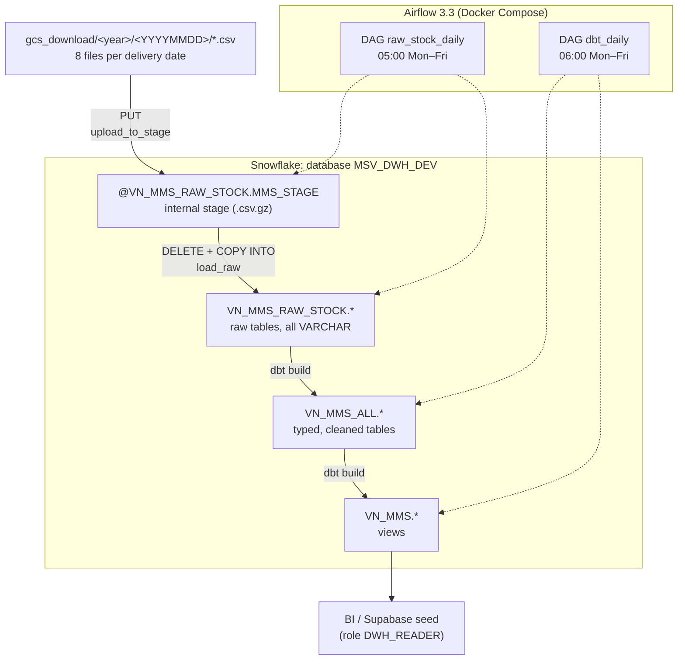

# snowflake-dwh

Data warehouse for MINISTOP Vietnam (`vn_ministop`) on Snowflake. It replaces the BigQuery
pipeline `vn_ministop_dwh`. Every day, 8 CSV files are loaded into raw tables and transformed by
dbt into tables and views for BI and the Supabase seed jobs.

The full migration plan and the setup steps are in
[docs/snowflake_migration_guide.md](docs/snowflake_migration_guide.md).

## Architecture



### Layers

| Layer | Location | Written by | Content |
|---|---|---|---|
| Files | `gcs_download/<year>/<YYYYMMDD>/<name>_<YYYYMMDD>.csv` | Placed by hand (not in git) | `category`, `pos`, `product`, `product_sales_report`, `promotion`, `promotion_bundle`, `store`, `vendor` |
| Stage | `@MSV_DWH_DEV.VN_MMS_RAW_STOCK.MMS_STAGE/<year>/<YYYYMMDD>/` | `ingest/load_raw.py` (`PUT`) | Compressed copies of the CSV files |
| Raw | `VN_MMS_RAW_STOCK.<NAME>` | `ingest/load_raw.py` (`COPY INTO`) | CSV columns as `VARCHAR`, plus `EXECUTE_TARGET_DATE`, `SOURCE_FILE`, `UPDATED_AT` |
| Transform | `VN_MMS_ALL.*` | dbt, `models/**/transform` | Typed tables: latest record per key, casts, cleaning |
| Serve | `VN_MMS.*` | dbt, `models/**/view` | Views that BI and Supabase read |

### Daily schedule (Asia/Ho_Chi_Minh)

| Time | DAG | Tasks |
|---|---|---|
| 05:00 Mon–Fri | `raw_stock_daily` | `resolve_date` → `check_files` → `upload_to_stage` → `load_raw` |
| 06:00 Mon–Fri | `dbt_daily` | `resolve_date` → `dbt_build` (`dbt build --vars '{event_date: ...}'`) |

- **Loads are idempotent.** `load_raw` deletes the date from all 8 raw tables and loads it again
  in one transaction, so a rerun replaces the date instead of duplicating it.
- **Missing or partial files.** If a date has no files, `check_files` skips the rest of the run.
  If only some of the 8 files are present, the run fails.
- **Header check.** `load_raw` stops if a CSV header no longer matches the raw table, because
  `COPY INTO` maps columns by position.
- **The two DAGs are independent.** They are only spaced 1 hour apart. If the raw load fails or
  runs late, trigger `dbt_daily` by hand once it has finished.

### Snowflake objects

| Object | Purpose |
|---|---|
| `MSV_DWH_DEV` | Development database (`MSV_DWH_PROD` is not created yet) |
| `WH_INGEST` | XS warehouse for upload and raw load |
| `WH_DBT` | XS warehouse for dbt, 30-minute statement timeout |
| `DWH_TRANSFORMER` | Role for ingest and dbt, used by service user `SVC_DBT_RUNNER` (key-pair auth) |
| `DWH_READER` | Read-only role on `VN_MMS` for BI and Supabase |
| `CSV_RAW`, `MMS_STAGE`, raw tables | Created by [sql/setup.sql](sql/setup.sql) |

## Repository layout

```
.
├── dags/
│   ├── raw_stock_daily.py      # files → stage → raw tables
│   └── dbt_daily.py            # dbt build
├── ingest/
│   ├── load_raw.py             # upload() and load() for one date, also runnable by hand
│   └── ingest.py               # one-off script: upload every folder in gcs_download/
├── dbt/                        # dbt project "vn_ministop"
│   ├── models/sources/         # source raw_stock → VN_MMS_RAW_STOCK
│   ├── models/idpos/transform/ # → VN_MMS_ALL (tables)
│   ├── models/idpos/view/      # → VN_MMS (views)
│   ├── seeds/                  # supplier_override
│   ├── macros/                 # schema and alias naming, event_date
│   └── profiles.yml            # Snowflake connection (key from env var)
├── sql/setup.sql               # file format, stage, raw tables
├── docs/snowflake_migration_guide.md
├── Dockerfile                  # Airflow image + snowflake connector + dbt virtualenv
├── docker-compose.yaml         # official Airflow compose file
└── docker-compose.override.yaml# mounts ingest/, dbt/, gcs_download/ and the key into the worker
```

Inside the worker image, dbt runs from its own virtualenv (`/opt/airflow/dbt-venv`), so its
dependencies do not conflict with Airflow's. `dbt/` is mounted read-only. dbt writes `target/`
and `logs/` to `/tmp/dbt` in the container.

### dbt naming

- Schema = the `+schema` value as written (`VN_MMS_ALL`, `VN_MMS`), with no target prefix.
- Table or view name = model name without `vn_ministop_` and `_table` / `_view`.
  For example, `vn_ministop_product_table` becomes `VN_MMS_ALL.PRODUCT`.

## Getting started

### Prerequisites
- Snowflake objects from Steps 1–4 of the migration guide.
- The private key `sf_dbt_runner.p8` in the project root (not in git).
- Docker with at least 4 GB of memory for Airflow.

### Run dbt locally
```bash
python3 -m venv .venv-dbt
.venv-dbt/bin/pip install -r dbt/requirements.txt

cd dbt
source ../.venv-dbt/bin/activate
export SNOWFLAKE_PRIVATE_KEY_PATH=$PWD/../sf_dbt_runner.p8
dbt parse --profiles-dir .                                # no warehouse cost
dbt build --profiles-dir . -s vn_ministop_product_table+  # runs on WH_DBT
```

### Run Airflow
```bash
echo "AIRFLOW_UID=$(id -u)" > .env
docker compose build
docker compose up airflow-init
docker compose up -d
```
Open <http://localhost:8080>, log in as `airflow` / `airflow` (local use only), and unpause both
DAGs. If you have more than one Docker context, select the one that runs Airflow first, for
example `export DOCKER_CONTEXT=default`.

### Reload or rebuild a past date
```bash
# Raw load
docker compose exec airflow-scheduler airflow dags trigger raw_stock_daily --conf '{"target_date": "20260825"}'
# dbt
docker compose exec airflow-scheduler airflow dags trigger dbt_daily --conf '{"event_date": "20260825"}'
```

## Status

Migration in progress (Step 6 of the guide).

| Group | Models | Status |
|---|---|---|
| Master | `category`, `shop`, `supplier`, `product`, `product_master` | Built on Snowflake, tests pass |
| Sales | `pos`, `pos_incl_wholesale`, `pos_daily_agg`, `pos_removal_plan`, `pos_removal_unmet`, `pos_remove_list` | Not ported. `pos_remove_list` raw is not loaded yet |
| Promotion | `promotion`, `promotion_bundle`, `product_sales_report` | Not ported |
| User and app | `user`, `active_app_user`, `user_app_used_by_event`, `user_mobiledevice_by_event` | Not ported. Source still to be checked |

Still to do: resource monitor `RM_DWH`, `MSV_DWH_PROD`, Supabase seed reading Snowflake, history
backfill, reconciliation with BigQuery and cut-over. See the checklist at the end of the
migration guide.
